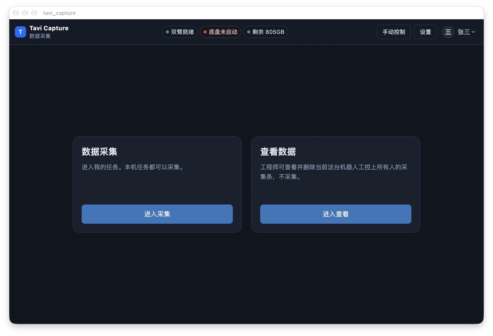
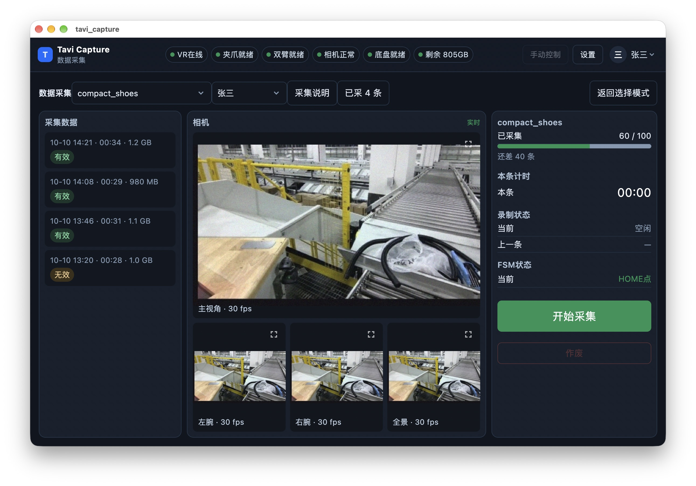

# Tavi Capture · 端侧采集平板

按 `端侧采集平板.html` 重做的 Flutter 客户端：连接机器人 → 登录 → 选任务 →
实时采集 / 查看回放。业务数据仍是原型里的模拟数据，**画面和关节是真数据**：

- 实时预览：LCM UDP 组播（相机 4 路 + 关节 `joint_batch_t`），在接收 isolate
  里完成组帧、分片重组和解码，UI 只拿完整帧。
- 回放：MCAP over HTTP Range，只读 footer/summary 和需要的 chunk，几 GB 的
  包也能按需打开。

平台：Android、iOS、macOS、Windows、Linux。**不支持 Web**（浏览器无法打开
裸 UDP 组播 socket）。

## 界面

| 首页 | 采集（LCM 实时画面） |
|---|---|
|  |  |

## 页面

| 页面 | 对应原型 | 说明 |
|---|---|---|
| 连接 | `s-setup` | 自动连接上次 IP，失败可改 IP 重连 |
| 登录 | `#loginMask` | 云端账号（张三/李四，1234）或本地密码 |
| 首页 | `s-home` | 数据采集 / 查看数据 |
| 我的任务 | `s-tasks` | 本机任务、拉取、下载 |
| 已采 | `s-done` | 全部/有效/无效、回看、继续采集 |
| 查看数据 | `s-library` | 任务/人员/有效性筛选、分页、回放、最大化 |
| 采集 | `s-collect` | 实时四路画面、进度、计时、录制、FSM、作废 |
| 回看 | `s-review` | 整屏回放 + 标记无效 |
| 设置 | `#settings` | IP、进程、日志、设备状态 |
| 手动控制 | `#move` | 一键连接、回 home 点、底盘方向键 |
| 异常恢复 | `#recover` | 设备掉线 / 启动失败 / 回位确认 / 作废确认 |

原型里有两个页面没有入口（已采列表、登录），这里补了两个不改变布局的入口：
顶栏右侧的人员按钮打开登录，采集页的「已采 N 条」按钮打开已采列表。

## 结构

```
lib/
  core/
    lcm/
      lcm_message.dart      UDP 数据报 → LCM 消息（长包按发送方+seq 重组）
      preview_protocol.dart preview_package_t 重组、joint_batch_t 解码、通道路由
      lcm_receiver.dart     组播/网卡/接收 isolate/背压，向上暴露帧和关节流
      multicast_lock.dart   Android MulticastLock
    mcap/        MCAP Range 读取、CDR 解码（Image / JointState / Statistics）
    app_state.dart   全部页面状态与动作（对应原型的全局变量）
    live_preview.dart  实时预览控制器：帧解码 + fps + 在线状态
    playback.dart      回放控制器：时间轴、seek、四路画面、三组关节曲线
    models.dart、theme.dart、scope.dart
  screens/      setup / home / tasks / done / collect / library / review / modals
  ui/           shell（顶栏 + 弹层 + toast）、相机网格、关节图、播放条、回放面板
tool/           mock_publisher.py、e2e_check、live_check、mcap_check
server/         单文件 MCAP Range 服务器（联调用）
```

## 运行

```bash
flutter pub get

# 没有机器人时只看 UI：跳过 IP 探测
flutter run -d macos --dart-define=DEMO=true

# 真机
flutter run -d macos --dart-define=ROBOT_IP=192.168.13.4
flutter run -d android --dart-define=ROBOT_IP=192.168.13.4
```

常用 `--dart-define`：

| 变量 | 默认 | 说明 |
|---|---|---|
| `ROBOT_IP` | `192.168.13.4` | 首屏默认 IP，也用于拼 MCAP 地址 |
| `MCAP_URL` | `http://<ROBOT_IP>:8090/rosbag_0.mcap` | 回放地址 |
| `DEMO` | `false` | 跳过机器人探测，方便看 UI |
| `LCM_GROUP` / `LCM_PORT` | `239.255.76.67:7667` | 相机组播 |
| `LCM_JOINT_GROUP` / `LCM_JOINT_PORT` | `239.255.76.68:7668` | 关节组播 |
| `LCM_IFACE` | 空 | 只加入指定网卡 |

## 本地联调

```bash
# 1) 假相机 + 假关节（同一台机器）
python3 tool/mock_publisher.py --host 127.0.0.1

# 2) 假 MCAP 服务器（任意 .mcap 都行）
go run ./server -file /path/to/data.mcap -addr 127.0.0.1:8090

# 3) App（DEMO 只是为了跳过 ping，实时画面照样收）
flutter run -d macos --dart-define=DEMO=true \
  --dart-define=MCAP_URL=http://127.0.0.1:8090/data.mcap
```

`tool/mock_publisher.py --help` 可以调相机名、帧率、关节数量；默认发
`cam_head/cam_chest/cam_left/cam_right` 四路 640×360 JPEG。

## 检查

```bash
flutter analyze
flutter test
dart run tool/e2e_check.dart    # Python 发布端 → Dart 接收端，端到端
dart run tool/live_check.dart 5 # 现场组播探针
dart run tool/mcap_check.dart http://<host>:8090/<file>.mcap  # MCAP 话题/解码
```

## 已知限制

- 任务、采集条、用户、进程、日志仍是原型里的模拟数据；录制服务未接，
  「停止并保存」只写内存，不会真的上传。
- 每一条采集条都指向同一个 `MCAP_URL`，这是原型行为；接后端后按记录存地址。
- MCAP 只支持未压缩 / `zlib` chunk，且文件必须带 summary。
- iOS 14+ 接收组播需要 Apple 的 `com.apple.developer.networking.multicast`
  entitlement（需申请，仓库里不放，避免签名失败）；`Info.plist` 已有本地网络说明。
- Android 已声明 `CHANGE_WIFI_MULTICAST_STATE` 并在采集期间持有 `MulticastLock`。
- Windows 需要放行 UDP 7667（专用网络）。
